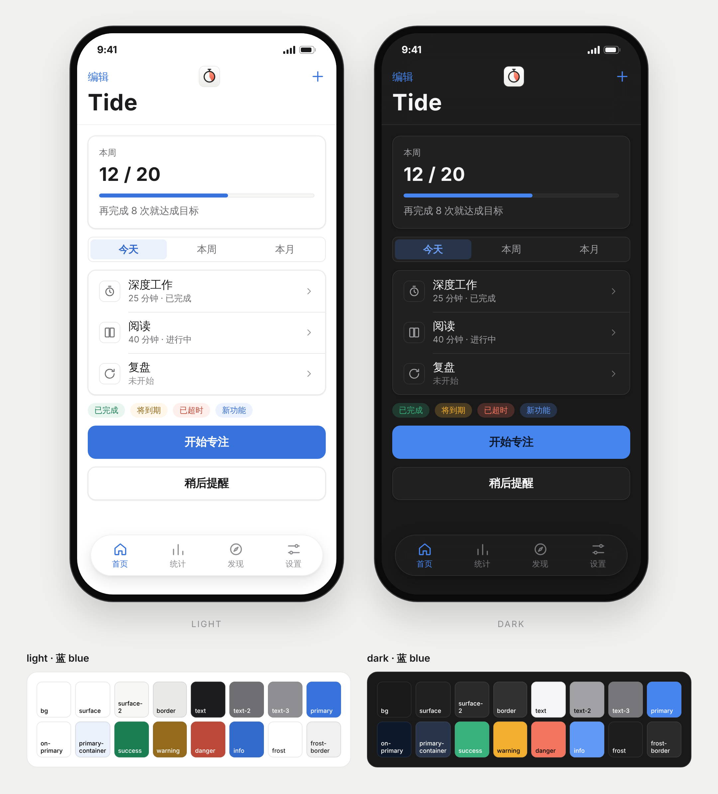

# rian-app-theme

一个 Claude skill：用 app 图标的强调色生成整套 UI 主题，包括浅色和深色两套颜色 token、字号、间距、圆角、投影、动效和磨砂材质，一次导出 CSS 变量、SwiftUI、Jetpack Compose 和 Tailwind，并渲染一张样例界面对照图。所有文字色和强调色都自动通过 WCAG 对比度检查。

风格是**极简线条**：白纸一样的中性色界面，1 px 细线分层，圆角收得紧，主色只出现在需要你按的地方；导航栏、标签栏和浮层用 Apple 式的半透明磨砂。中性色和细线学 Notion，磨砂、字号和圆角学 Apple，色彩角色和可访问性学 Google。它和图标 skill [rian-app-icon](https://github.com/RianStudio/app_logo_design_skill) 用同一套强调色和同一种圆头圆角的线条，图标放进界面里是一家人。



## 安装

**Claude Code**：把整个仓库复制到 `~/.claude/skills/rian-app-theme/`（个人）或项目里的 `.claude/skills/rian-app-theme/`。

**Claude.ai / Claude 桌面版**：把仓库打成 zip，在 Settings → Capabilities → Skills 上传。

预览脚本需要一次性安装：

```bash
pip install playwright && playwright install chromium
```

## 用法

直接对 Claude 说，例如：

> 给 Tide 做一套 UI 主题。

默认主色是**蓝**。图标是绿、紫或灰时，界面可以跟着用同一个颜色；珊瑚、黄这类暖色只留在 app 图标里，不做界面主色。

也可以直接跑脚本：

```bash
python3 scripts/build.py --name Tide -o themes/tide               # 蓝
python3 scripts/build.py --name Tide --accent 紫 -o themes/tide   # 蓝 绿 紫 灰，中英文都可以
python3 scripts/preview.py themes/tide --icon tide-1024.png
```

## 示例

| 示例 | 强调色 | 主色（浅 / 深） |
|---|---|---|
| [Tide 专注计时](examples/tide/) | 蓝 | `#3773DB` / `#4785EE`；图标仍是珊瑚 |
| [Margin 笔记](examples/margin/) | 蓝 | `#3773DB` / `#4785EE` |

## 结构

```
SKILL.md                    工作流程（Claude 读这个）
references/rules.md         主题规则、颜色、token、组件用法、图标、接入方式
assets/palette.json         强调色（与 rian-app-icon 相同）和中性色
scripts/build.py            强调色 → tokens.json / theme.css / Theme.swift / Theme.kt / tailwind.preset.js
scripts/preview.py          样例界面浅色 + 深色对照图
examples/                   两套示例主题
```

## License

MIT
