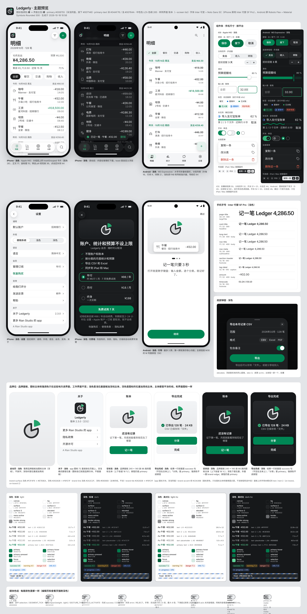

# rian-app-theme

一个 Claude skill：用 app 图标的强调色生成整套 UI 主题。颜色 token 有深浅两种模式 × 标准和高对比两档，共四套；另有手机和桌面两套字号，以及间距、圆角、阴影、尺寸、动效、触感、媒体色组（编辑器和查看器的中性画布、遮罩、棋盘格）、frost 材质和界面图标规范。一次导出 CSS 变量、SwiftUI、Jetpack Compose 和 Tailwind，并渲染一张以手机为主的对照图：样例界面的 iPhone 浅色和深色、Android，加上设置、付费墙、引导这些共用外壳，或者编辑器、查看器、AI 对话这些页面；桌面窗口可选。所有文字色和主色都放在每个表面和玻璃上检查 WCAG 对比度，标准和高对比两档任何一项不过，脚本就不输出。

风格是**石墨**（Linear 式，iOS 走 Apple HIG，Android 走 M3 Expressive）：深石墨和纸白两套中性色阶梯，在 CIE LCh 里从同一个色相（265）推导出来；用 1 px 发丝线和明度差分层，卡片不加投影；单一强调色，只用在主按钮、焦点、链接、进度这几处；照片和生成结果放在彩度 0 的中性画布上；手机优先，沿用平台字号和点击区；每个动作一个名字，能搜到；键盘层（⌘K 命令菜单、快捷键提示）是可选的，只在桌面、Web 和接了键盘的 iPad / Mac 上出现，桌面排得密（正文 13–14、行高 36）。规则里还写了编辑器和查看器、视频、AI 对话和生成、长任务（确定进度、取消、后台继续）、引导和付费墙、设置和关于页，以及简繁英三语的术语表。线条、密度和克制学 Linear；控件按平台走：iOS 照 Apple HIG（iOS 26 Liquid Glass），Android 照 Material 3 Expressive，颜色、品牌位和断言两端共用。它和图标 skill [rian-app-icon](https://github.com/RianStudio/app_logo_design_skill) 用同一套强调色和同一种石墨：界面图标是 1.5 px 的 Lucide 细线，图标是同一种圆头细线（1024 上 60 px）；启动页、引导、付费墙、空状态、导出完成页这些品牌位放一块顶光的品牌面板（深色是图标的石墨，浅色是浅石墨），插图就是图标自己的线稿，平涂、线宽跟着整体缩放（浅色深线，深色亮线），图标的强调色原色只出现在那里，按钮仍用界面主色；关于页的 app 图标深浅都是石墨。



## 安装

**Claude Code**：把整个仓库复制到 `~/.claude/skills/rian-app-theme/`（个人）或项目里的 `.claude/skills/rian-app-theme/`。

**Claude.ai / Claude 桌面版**：把仓库打成 zip，在 Settings → Capabilities → Skills 上传。

预览脚本需要一次性安装：

```bash
pip install playwright pillow numpy && playwright install chromium
```

第一次预览会从 Google Fonts 下载 Inter、Roboto Flex、Material Symbols Rounded 和用到的 Noto Sans SC 字，缓存在 `~/.cache/rian-app-theme/fonts`；离线时加 `--offline` 用本机字体。

## 用法

直接对 Claude 说，例如：

> 给 Ledgerly 做一套 UI 主题。

界面主色按图标的强调色定：蓝→蓝，绿→绿，紫→紫；珊瑚、黄、灰只留在 app 图标里，界面用蓝。还没有图标时按类别（`--category`）：AI 紫；工具、图片、视频蓝；健康、财务绿。都没有时是蓝。红色永远不做界面主色。中性色永远是石墨，不跟主色变。

也可以直接跑脚本：

```bash
python3 scripts/build.py --name Ledgerly --accent 绿 -o themes/ledgerly   # 传图标强调色的色名，中英文都可以
python3 scripts/preview.py themes/ledgerly --screen list \
  --icon icons/ledgerly-1024.png --icon-dark icons/ledgerly-dark.png

python3 scripts/build.py --name Ask --category AI -o themes/ask           # 还没有图标：按类别定主色（AI → 紫）
python3 scripts/preview.py themes/ask --screen chat                       # 不传 --icon 时是石墨占位图
```

`icons/` 是 rian-app-icon 的 `render.py ledgerly.svg -o icons --variants` 的输出目录，里面有默认外观 `ledgerly-1024.png`、深色外观 `ledgerly-dark.png` 和平涂的图标主体 `ledgerly-mark.png`（亮线，深色面板）、`ledgerly-mark-light.png`（深线，浅色面板）。引导、付费墙、空状态这些品牌位的插图用它们，`preview.py` 在 `--icon` 旁边自动找到；没有时从图标 PNG 里抠出来再压平。

`build.py` 全部通过时打印 `contrast: all pass (standard, high)`；`preview.py` 在主题目录里写出 `preview.png`（1960 宽的画板，2x 截图），最后打印断言，都应该是 PASS，有 FAIL 时退出码是 1：

- `frost light`、`frost dark`、`frost photo light`、`frost photo dark`：栏上文字对滚到下面的列表和照片 ≥ 3:1；
- `viewer scrim`：查看器的白色控件透过遮罩叠在亮照片上 ≥ 4.5:1；
- `accent area phone`、`accent area conversion`：主色面积手机 ≤ 8 %，引导、付费墙、权限预请求、同意页和示例空状态这类转化界面 ≤ 15 %，照片、生成的图和品牌插图不算；
- `safe area`：付费墙、引导和底部弹窗的内容都在 Home 指示条上方结束；
- 加 `--desktop` 时还有 `accent area desktop`：桌面窗口 ≤ 5 %。

`--screen` 选样例界面：`timer`（默认）、`notes`、`list` 是列表型 app，第二行是设置、付费墙、引导；`editor` 是照片编辑（编辑、抠图导出、裁剪、图库、查看器、权限预请求）；`chat` 是 AI 对话和生成（对话、生成状态、示例空状态、第三方 AI 同意、点数付费墙、举报）。`--desktop` 给前三种加一个打开 ⌘K 的桌面窗口，`--desktop-mode light` 把它换成浅色。

## 示例

| 示例 | 图标色 | 界面主色 | `primary`（深浅同值） | `primary-text`（深 / 浅） | 样例界面 |
|---|---|---|---|---|---|
| [Ledgerly 记账](examples/ledgerly/) | 绿 | 绿 | `#008755` | `#34AF76` / `#00764A` | `list` |
| [Tide 专注计时](examples/tide/) | 珊瑚 | 蓝 | `#2B72E0` | `#6E97FF` / `#0064CD` | `timer` |
| [Margin 笔记](examples/margin/) | 黄 | 蓝 | `#2B72E0` | `#6E97FF` / `#0064CD` | `notes` |

色值来自当前的 `build.py`，以各示例 `tokens.json` 的 `color.*.primary`、`color.*.primary-text` 为准；高对比档的 `primary-text` 更亮或更暗一档（绿 `#5FD599` / `#005B38`，蓝 `#ADBDFF` / `#004CA0`）。Tide 和 Margin 的图标是暖色，界面都换成蓝，所以两套颜色只差名字和记下的图标色；Ledgerly 的图标是绿，界面跟着用绿。重新生成：

```bash
ICON_SKILL=~/.claude/skills/rian-app-icon   # rian-app-icon 仓库的位置，按实际改
python3 $ICON_SKILL/scripts/render.py $ICON_SKILL/examples/ledgerly.svg -o /tmp/icons --variants   # 写出 /tmp/icons/ledgerly-1024.png、ledgerly-dark.png 和两份 mark
python3 scripts/build.py --name Ledgerly --accent 绿 -o examples/ledgerly
python3 scripts/preview.py examples/ledgerly --screen list \
  --icon /tmp/icons/ledgerly-1024.png --icon-dark /tmp/icons/ledgerly-dark.png
```

Tide 把 `ledgerly`、`Ledgerly`、`绿`、`list` 换成 `tide`、`Tide`、`珊瑚`、`timer`。Margin 的旧图标已经从 rian-app-icon 删掉（旧风格），重新生成时用 `--name Margin --accent 黄 -o examples/margin`，预览用 `--screen notes` 并省略 `--icon` 和 `--icon-dark`，图标位置是石墨占位图，插图是占位主体。Tide 和 Margin 的图标是暖色，预览里手机字号表下面是「图标 × 界面」；Ledgerly 那格是这个界面的底部弹窗。示例都没有加 `--desktop`。想看照片编辑和 AI 对话的样子，先把一个示例复制出来再渲染，`preview.py` 会把 `preview.png` 写回主题目录，直接在 `examples/` 里跑会盖掉提交的图：

```bash
cp -r examples/tide /tmp/tide && python3 scripts/preview.py /tmp/tide --screen editor
python3 scripts/build.py --name Ask --category AI -o /tmp/ask && python3 scripts/preview.py /tmp/ask --screen chat
```

## 结构

```
SKILL.md                    工作流程（Claude 读这个）
references/rules.md         主题规则：颜色和对比度、媒体色组、token、组件用法、编辑和查看、视频、AI、长任务、转化界面、共用外壳和术语表、
                            命令菜单和键盘层、UX 模式、图标、平台适配、接入方式
assets/palette.json         强调色（与 rian-app-icon 相同）、类别、石墨中性色的 LCh 输入（base、ladder、text、alpha）、媒体色组
scripts/build.py            强调色 → tokens.json / theme.css / Theme.swift / Theme.kt / tailwind.preset.js（四套颜色，断言对比度）
scripts/preview.py          对照图：六部手机（样例界面和共用外壳，或编辑器、AI 页面）、组件条、手机字号表、四套色板和媒体色组，
                            可选的桌面窗口；量 frost、查看器遮罩和主色面积
examples/                   三套示例主题
```

## License

MIT
